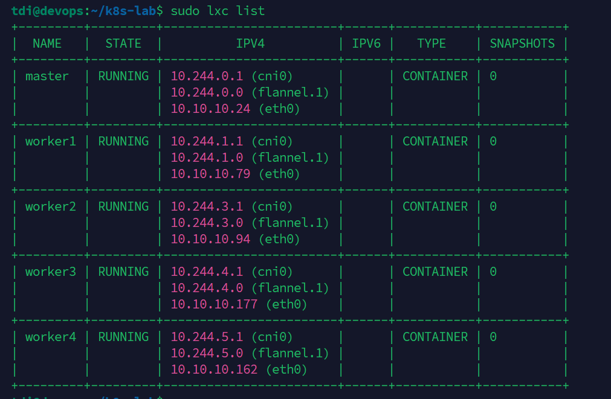
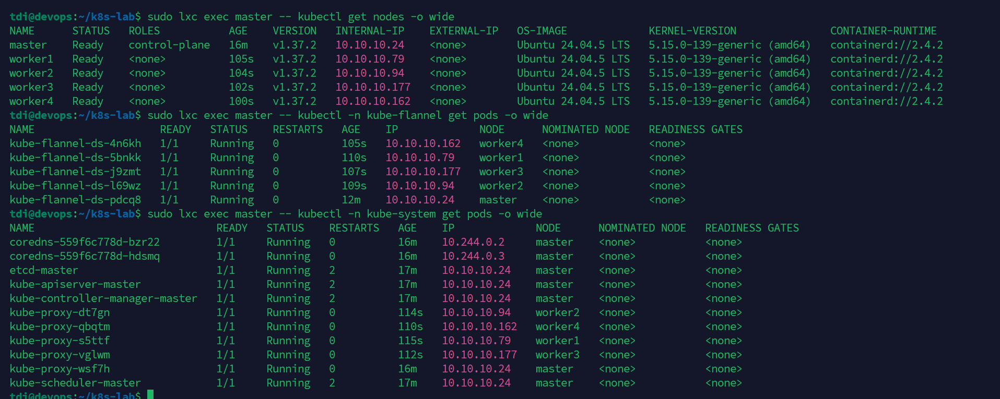
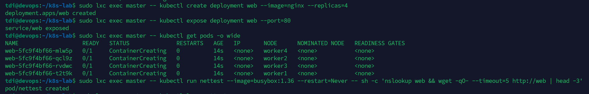
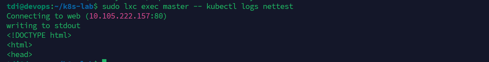
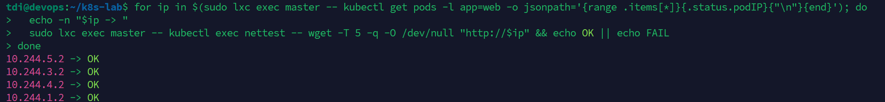

# Разворот кластера Kubernetes

## Выполнение задания - Задание 1. Установить кластер k8s с 1 master node 

Первоначально планировал развернуть в рамках VM сред через Vagrant в VMBox
но решение не взлетело из-за проблемы -  VBoxManage: error: VT-x is not available (VERR_VMX_NO_VMX)
внешняя VM не отдаёт гостю флаг VMX.
После чего принял решение разворачивать на LXC контейнерах в рамках самой VM.
Реализация этого решения тоже оказалось не простой, работы на пару вечеров.

Но по итогу удалось поднять кластер K8S на LXC:

По итогу поднятый кластер из мастера и 4-х воркеров

и небольшой smoke-тест

Проверка связанности

---

## Выполнение задания - Задание 2. Установить HA кластер
